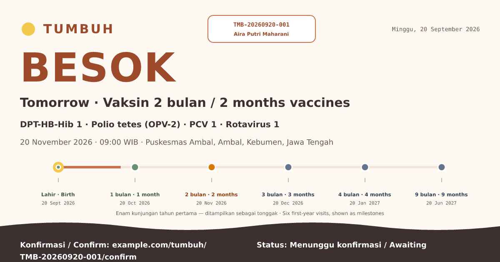

# TUMBUH — Baby's First Year Kit

One birth date, four outputs, zero discrepancy: a first-year
immunisation kit for a newborn, built with **Hyper Elements**
(`@hyper-elements/react`) for the **Unlayer Hyper Elements Template
Challenge** ($500 prize pool, 5 winners × $100, judged on originality,
design quality, practical value, effective Hyper Elements use, and
execution).

## What it is

**TUMBUH** turns a single birth date into everything a parent needs
for their baby's first year:

1. **Birth email** — the announcement a parent opens on their phone:
   welcome, birth details, the next vaccine with its countdown, the
   appointment and its confirmation status, the first year at a
   glance, what the next vaccines protect against
   (`src/BirthEmail.tsx` → `BirthEmail.html` + `.txt`).
2. **Schedule page** — the dashboard for the whole first year: the
   baby's age, the countdown to the next vaccine, the timeline, the
   full schedule table, the appointment and its confirmation status,
   the colour legend, what the next vaccines protect
   (`src/SchedulePage.tsx` → `SchedulePage.html`).
3. **Appointment card (PDF, A4, 2 pages)** — the printable sheet: the
   next appointment, what to bring (checklist), how to confirm, and
   the full first-year schedule on page 2
   (`src/AppointmentCard.tsx` → `AppointmentCard.pdf`).
4. **Reminder card (1200 × 630)** — the share image for WhatsApp and
   social media: the next vaccine in giant type, "BESOK / TOMORROW",
   the six-visit timeline as milestones, the confirmation link and
   the status (`src/ReminderCard.tsx` → `ReminderCard.png`).

The sharp idea is **"one birth date, one schedule"**: every output
carries the same child ID (`TMB-20260920-001`), built from the birth
date. In a baby's first year, the most dangerous failure is not a
missed vaccine — it is two reminders that disagree about when it is
due. The kit makes disagreement impossible by construction: all four
outputs are rendered from **one data file** (`src/data.ts`) and **one
theme** (`src/theme.ts`), and every derived value — the due dates, the
status of each visit, the countdown ("tomorrow", "in 31 days"), the
age, the child ID — is **computed by code** from the birth date, never
typed in per output. Change the birth date and every due date, every
status and every countdown changes with it.

Six things no other entry in the challenge does:

- **Two languages** — every label is Indonesian + English from the
  same data, so the two versions can never drift apart.
- **Computed time** — due dates and the "next vaccine in X days"
  countdown are arithmetic on the birth date, not text.
- **Real medical rules** — the schedule is the real IDAI 2024 /
  Kemenkes 2025 immunisation schedule (see below).
- **A recipient response loop** — the appointment carries a
  "Confirm appointment" action (Button / Link to the clinic's
  confirmation URL for this child ID) and a confirmation status as a
  data field, so the clinic can tell a confirmed appointment from a
  waiting one — on every output.
- **A human story** — a baby's first year, not a form: the welcome,
  the age in months and days, the milestones.
- **Proof** — one child ID on all four outputs, so a printed card can
  be matched to the email and the page without doubt.

## Screenshots



*The reminder card (`output/src/ReminderCard.png`, 1200 × 630): the
next vaccine, the countdown, the six-visit timeline, the confirmation
link and status, and the child ID that ties it to the email, the page
and the appointment card. (A full-page screenshot of the schedule page
could not be rendered on this machine — headless Chromium is blocked
here — so the README ships the card as the visual; the schedule page
itself is verified by `npm run check` and by content checks below.)*

## How Hyper Elements is used

The kit is written entirely as Hyper Elements components — no
hand-written HTML, no raw `<style>`, no image assets at all (every
visual is drawn in code: SVG timelines, an SVG sun and hills, colour).
The four roots share one data file, one theme and one set of shared
components (`src/shared.tsx`).

| Component | Where / how it is used |
| --- | --- |
| `Email` | Root of the birth announcement. `width={600}`, `previewText`, `title`, `lang="id"`, `theme={tumbuhTheme}`. A terracotta masthead band with the child badge, the welcome hero, the next-vaccine card with the countdown, the first-year-at-a-glance bars, what the vaccines protect, and the proof strip with the confirm button. `MergeTag name="first_name"` personalises the greeting; the CLI also emits the plain-text version. |
| `Page` | Root of the schedule dashboard. `width={1120}`, hero band with the age, the countdown and the appointment in giant figures, `Grid columns={2}` for timeline + appointment and for legend + protects, the full schedule table, and the proof strip. |
| `Document` | Root of the printable card. `size="A4"`, `orientation="portrait"`, two `Document.Page`s: page 1 (the appointment, what to bring, how to confirm) and page 2 (the full first-year schedule, the colour legend, proof). `PageNumber` / `PageNumber total` in the footers; DejaVu fonts registered for the PDF renderer. The confirm action has no button here — a PDF has no hover — so the card prints the confirmation URL as text instead. |
| `Canvas` | Root of the share card. `width={1200} height={630}`: giant countdown, the next vaccine, the appointment line, an SVG timeline of the six visits, an SVG sun and hills into a dark band with the confirmation link and the status. |
| `defineTheme` + `token()` | `src/theme.ts`: the brand written once — the warm palette (cream, terracotta, sage, amber, slate, ink), Georgia serif headings, body size/line-height, Heading type scale, Button defaults, and a named `card` style applied with `style={{ apply: ["card"] }}`. `token("colors.muted")` / `token("colors.border")` resolve theme tokens inside the templates. The terracotta band and the muted text were darkened until they pass 4.5:1 body-text contrast on both white and cream. |
| `Svg` / `Rect` / `Line` / `Path` / `Circle` | The first-year timeline (`VisitTimelineSvg` in `src/shared.tsx`): one dot per visit coloured by its status, a progress line to "today", tick labels with the due dates; the visit bars in the email (`VisitBars`); the sun and the hills on the reminder card. |
| `Table` / `TableRow` / `TableCell` | The schedule table (visit / vaccines / due / status) on the page and on page 2 of the appointment card. |
| `Row` / `Column` / `Grid` | All layout. `Grid columns={2}` for timeline + appointment and for legend + protects on the page. |
| `Heading` | One `level={1}` per template; `level={2}` section titles, `level={3}` kickers. |
| `Text` / `Span` / `Divider` / `Button` / `Link` | Body copy, bilingual label pairs (`Bi` in `src/shared.tsx`), monospace figures (`fontFamily`), tracked-out uppercase kickers (`letterSpacing` + `textTransform`), section dividers, the "Konfirmasi Janji Temu / Confirm Appointment" button (email + page) and the "Jadwal ulang / Reschedule" link. |

## The data — real, and computed, not typed

The schedule and the scenario come from the real Indonesian
immunisation rules:

- **IDAI (Ikatan Dokter Anak Indonesia) 2024 & Kemenkes RI 2025** —
  the basic first-year schedule: Hepatitis B (HB-0) within 24 hours;
  BCG + Polio drops (OPV-1) within 1 month; DPT-HB-Hib 1 + Polio
  (OPV-2) + PCV 1 + Rotavirus 1 at 2 months; DPT-HB-Hib 2 + Polio
  (OPV-3) + PCV 2 + Rotavirus 2 at 3 months; DPT-HB-Hib 3 + Polio
  (OPV-4) + injectable Polio (IPV-1) + Rotavirus 3 at 4 months;
  Measles-Rubella (MR) + injectable Polio (IPV-2) at 9 months, plus
  Japanese Encephalitis (JE) in endemic areas only — marked
  conditional on every output.
- **Scenario** — a fictional baby, **Aira Putri Maharani, born Sunday
  20 September 2026, 08:15 WIB, 3.2 kg, 49 cm**, at Puskesmas Ambal,
  Ambal, Kebumen. The reference date ("today" in the data) is
  **Thursday 19 November 2026** — the baby is 60 days old (1 month
  30 days). HB-0 was given on the birth day; BCG + OPV-1 were given on
  15 October 2026 (25 days old, inside the under-1-month window). The
  2-months vaccines fall due **Friday 20 November 2026 — tomorrow, in
  1 day**; the 3-months visit on 20 December 2026 (in 31 days), the
  4-months visit on 20 January 2027 (in 62 days), the 9-months visit on
  20 June 2027 (in 213 days). The appointment is 20 November 2026,
  09:00 WIB, status "awaiting confirmation". Every output says this is
  a sample scenario, not a real medical record; the clinic, the birth
  weight/length and the given dates are illustrative, while the
  schedule rules and the date arithmetic are real.
- **Date arithmetic** — `src/data.ts` holds the birth date and the
  visits; `dueDate(data, visit)` adds the visit's age in months to the
  birth date; `visitStatus(data, visit)` derives done / due-soon /
  upcoming / overdue from the due date and the reference date;
  `countdownLabel` turns the gap into "tomorrow" / "in X days";
  `childId` builds `TMB-20260920-001` from the birth date. Dates are
  parsed as UTC noon and all math is UTC-based, so a due date can
  never slip a day when the machine's timezone differs from WIB.
  Swap the sample birth date for a real one and all four outputs
  follow.

## Run it

```bash
npm install
npm run typecheck   # tsc --noEmit
npm run check       # hyper-elements check src (0 errors, 0 warnings)
npm run render      # hyper-elements render src --out output
```

Outputs land in `output/src/`:

| File | What it is |
| --- | --- |
| `BirthEmail.html` (+ `.txt`) | The birth announcement email, HTML + plain text |
| `SchedulePage.html` | The first-year schedule dashboard page |
| `AppointmentCard.pdf` | The printable A4 appointment card (2 pages) |
| `ReminderCard.png` | The 1200 × 630 reminder card |

Fonts: DejaVu Sans / DejaVu Sans Mono (regular + bold) live in
`assets/fonts/` and are registered for the PDF and image renderers
(`PRINT_FONTS` in `src/theme.ts`); the email and page use the system
font stack from the theme. The Canvas and Document roots need their
renderers installed (`satori`, `@resvg/resvg-js`,
`@react-pdf/renderer` — already in `package.json`).

## Notes for the judges

- **Originality** — no other entry in the challenge covers a baby's
  first year, immunisation, or a bilingual template; the "one birth
  date, one schedule" proof idea (the same child ID on all four
  outputs) is the kit's answer to the multi-output pattern the
  strongest entries use, and the computed countdown plus the
  recipient confirmation loop are things no other entry has.
- **Design** — warm, soft, and deliberately different from an
  emergency system: cream and terracotta, one badge, one timeline
  language, one voice across all four outputs. The status colour *is*
  the information: sage done, amber due soon, slate upcoming, red
  overdue.
- **Practical value** — a real workflow a clinic or a parent could
  actually run: one data file in, four ready-to-send outputs out;
  real medical rules, a real clinic, a printable card, a shareable
  reminder.
- **Hyper Elements use** — all four roots (Email, Page, Document,
  Canvas) from one codebase, plus SVG timelines, theme tokens, and the
  `PageNumber` / font registration the Document and Canvas roots need.
- **Execution** — `npm run check` is 0 errors, 0 warnings;
  `npm run render` produces all four outputs; every output was
  verified (reminder card and both PDF pages read as images; the
  plain-text email read in full; the page and email HTML
  content-checked for the child ID, the due dates, the countdown and
  the bilingual labels). Verification caught a real bug — every due
  date rendered one day early because local-time date construction
  clashed with WIB formatting — and it was fixed in the date helpers,
  not patched per output.
